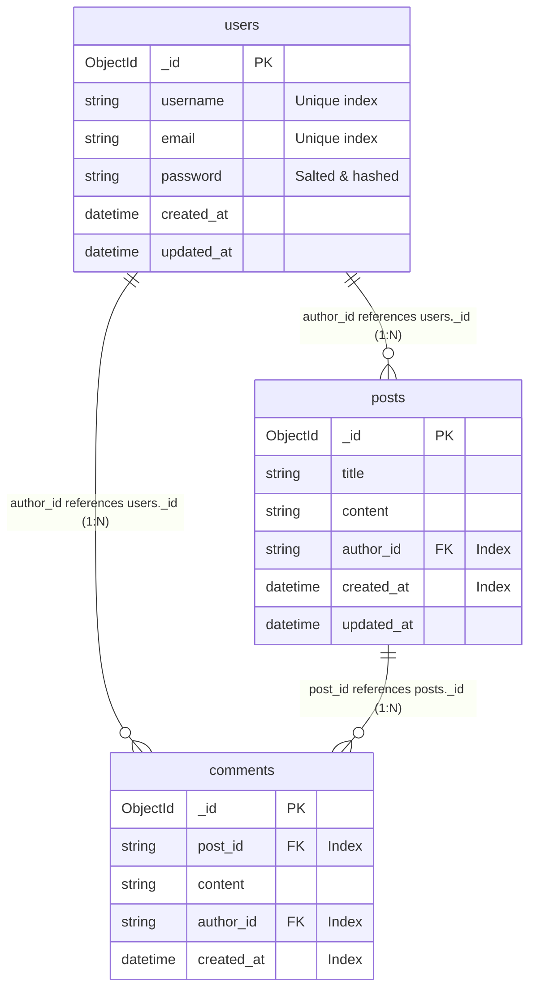

# BlogNest MongoDB Database Schema & Setup Guide

## Architecture Overview

BlogNest uses **MongoDB** as its primary document-oriented NoSQL database. MongoDB's flexible JSON-like BSON documents allow high read/write performance, horizontal scalability, and nested referencing between collections.



---

## Collections & Document Schemas

### 1. `users` Collection
Stores user accounts and credentials.

```json
{
  "_id": ObjectId("671b56a1e9447376c9682701"),
  "username": "johndoe",
  "email": "johndoe@example.com",
  "password": "scrypt:32768:8:1$hU6zX...",
  "created_at": ISODate("2026-10-25T12:00:00.000Z"),
  "updated_at": ISODate("2026-10-25T12:00:00.000Z")
}
```

- **Indexes**:
  - `{"username": 1}` with `unique=True`
  - `{"email": 1}` with `unique=True`

---

### 2. `posts` Collection
Stores published blog articles with a foreign reference (`author_id`) to the `users` collection.

```json
{
  "_id": ObjectId("671b56b3e9447376c9682702"),
  "title": "Getting Started with Python & MongoDB",
  "content": "Full article markdown or text content...",
  "author_id": "671b56a1e9447376c9682701",
  "created_at": ISODate("2026-10-25T12:05:00.000Z"),
  "updated_at": ISODate("2026-10-25T12:05:00.000Z")
}
```

- **Indexes**:
  - `{"author_id": 1}` (Fast filtering by author)
  - `{"created_at": -1}` (Fast chronological feed sorting)

---

### 3. `comments` Collection
Stores discussions linked to a post (`post_id`) and written by an author (`author_id`).

```json
{
  "_id": ObjectId("671b56c0e9447376c9682703"),
  "post_id": "671b56b3e9447376c9682702",
  "content": "Great explanation! Very easy to understand.",
  "author_id": "671b56a1e9447376c9682701",
  "created_at": ISODate("2026-10-25T12:10:00.000Z")
}
```

- **Indexes**:
  - `{"post_id": 1}` (Retrieving comments for a post)
  - `{"author_id": 1}` (Tracking user comment history)
  - `{"created_at": -1}` (Chronological sorting)

---

## MongoDB Setup & Connection

### 1. Environment Configuration (`.env`)
Configure the `MONGO_URI` and `MONGO_DBNAME` variables:

```env
# Local MongoDB Server
MONGO_URI=mongodb://localhost:27017/blognest_db
MONGO_DBNAME=blognest_db

# Or MongoDB Atlas Cloud Cluster:
# MONGO_URI=mongodb+srv://<username>:<password>@cluster0.mongodb.net/blognest_db?retryWrites=true&w=majority
```

### 2. Initialize Indexes
Run the automated initialization script to prepare MongoDB collections and indexes:

```bash
cd blog-application-api
python init_db.py
```

### 3. Cascade Deletions
When a post is deleted via `DELETE /api/posts/<id>`, the API automatically triggers a `delete_many({"post_id": post_id})` across the `comments` collection, preventing orphaned comments.
